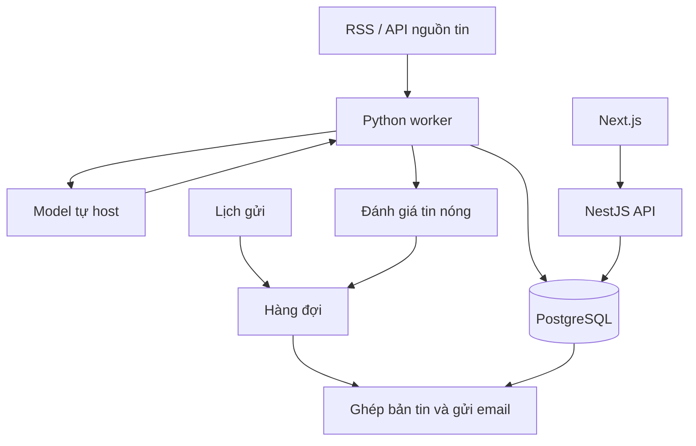

# Kiến trúc và triển khai

## Trạng thái lựa chọn

- Đã xác định: Next.js cho frontend, NestJS cho backend; dự kiến deploy AWS.
- Định hướng của người dùng: AI local để tóm tắt tin.
- Đề xuất: Python worker xử lý pipeline tin tức, PostgreSQL lưu dữ liệu và hàng đợi điều phối tác vụ.
- Chưa chốt: model, công cụ phục vụ model, hạ tầng AWS cụ thể và phương án chạy local hay trên server.
- FastAPI chưa bắt buộc; chỉ thêm khi Python cần cung cấp API HTTP, ví dụ tóm tắt theo yêu cầu từ giao diện.

## Thành phần đề xuất

| Thành phần | Trách nhiệm |
| --- | --- |
| Next.js | Đăng ký, quản lý sở thích, lịch nhận, xem bản tin cũ |
| NestJS | API, người dùng, sở thích, điều phối job và lịch sử gửi |
| Python worker | Thu thập, làm sạch, gom sự kiện, phân loại, gọi model và lưu tóm tắt |
| Model tự host | Sinh bản tóm tắt từ nội dung được cung cấp |
| PostgreSQL | Người dùng, nguồn tin, bài viết, sự kiện, bản tóm tắt và trạng thái gửi |
| Hàng đợi | Tách xử lý nền, kiểm soát tốc độ, retry |
| Dịch vụ email | Gửi bản tin và ghi nhận kết quả gửi |



## Cấu trúc repository đề xuất

```text
apps/
  web/          # Next.js
  api/          # NestJS
  worker/       # Python
shared/         # Hợp đồng dữ liệu và tài nguyên dùng chung
infra/          # Cấu hình hạ tầng AWS
docs/
compose.yaml    # Môi trường local, chưa được tạo
```

Đề xuất dùng pnpm workspace cho phần JavaScript/TypeScript; Python quản lý môi trường và dependency riêng. Hợp đồng job cần tương thích giữa NestJS và Python.

## Phương án AWS

### MVP ưu tiên chi phí

Chạy web/API bằng Docker Compose trên một EC2. PostgreSQL có thể chạy cùng máy với volume và backup. Đây là phương án đề xuất, có điểm lỗi chung ở một server và cần tự quản lý cập nhật, backup, HTTPS.

Model có thể chạy trên máy cá nhân trong thời gian thử nghiệm; xem [AI local](./local-ai.md).

### Khi cần mở rộng

- ECS Fargate cho web/API và worker không cần GPU; chọn hạ tầng hỗ trợ GPU riêng nếu model yêu cầu GPU.
- RDS PostgreSQL cho dữ liệu.
- SQS làm hàng đợi chung cho NestJS và Python.
- EventBridge Scheduler kích hoạt job theo lịch và múi giờ.
- SES gửi email.
- ECR lưu container image; CloudWatch theo dõi log và lỗi.
- Application Load Balancer và ACM cho HTTPS khi dùng ECS.

Amplify Hosting là lựa chọn khác cho Next.js; phải kiểm tra phiên bản và tính năng được hỗ trợ trước khi chọn.

## Độ tin cậy và gửi email

- Xử lý job theo hướng idempotent vì SQS Standard có thể giao trùng message.
- Lưu trạng thái bản tin và lần gửi; dùng khóa logic theo người dùng/ngày/loại bản tin để giảm nguy cơ gửi trùng.
- Retry có giới hạn, có nơi lưu job thất bại để kiểm tra và xử lý lại.
- Theo dõi kết quả gửi; xử lý bounce, complaint và hủy đăng ký.
- Với SES, xác minh domain gửi và xin production access trước khi gửi tới người dùng chưa xác minh địa chỉ.

## Checklist setup đề xuất

1. Khởi tạo web, API, Python worker và môi trường local.
2. Thêm migration cơ sở dữ liệu, `.env.example` và kiểm tra cấu hình khi khởi động.
3. Giữ credential và khóa dịch vụ ở backend/worker.
4. Thêm Dockerfile, health endpoint cho HTTP service và log ra stdout.
5. CI chạy lint, kiểm tra kiểu, build và kiểm thử phù hợp.
6. CD build image, đẩy ECR và cập nhật ứng dụng; GitHub Actions dùng OIDC để xác thực AWS.
7. Migration chạy thành bước deploy riêng; cấu hình backup và theo dõi lỗi.

## Tài liệu tham khảo

- [EventBridge Scheduler: lịch và múi giờ](https://docs.aws.amazon.com/scheduler/latest/UserGuide/schedule-types.html)
- [Chạy ECS task theo lịch](https://docs.aws.amazon.com/AmazonECS/latest/developerguide/tasks-scheduled-eventbridge-scheduler.html)
- [SQS Standard queues](https://docs.aws.amazon.com/AWSSimpleQueueService/latest/SQSDeveloperGuide/standard-queues.html)
- [SES production access](https://docs.aws.amazon.com/ses/latest/dg/request-production-access.html)
- [Next.js trên Amplify Hosting](https://docs.aws.amazon.com/amplify/latest/userguide/ssr-amplify-support.html)
