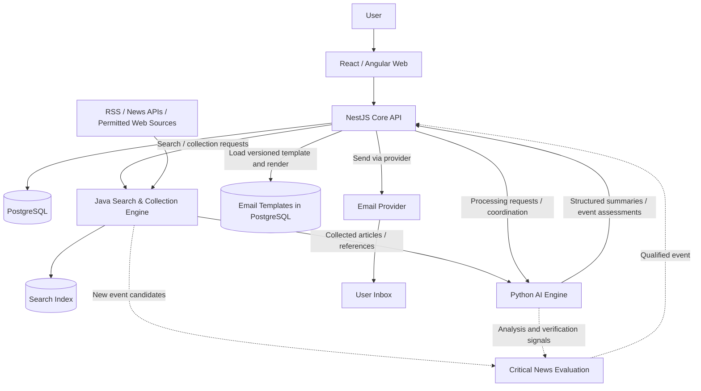

# AI Daily News Collective — Kiến trúc và triển khai

> Phiên bản: 0.2 — Cập nhật theo các quyết định kiến trúc ngày 12/11/2026.
> Tài liệu định hướng kiến trúc; các mục chưa chốt được đánh dấu rõ ràng.

## 1. Mục tiêu sản phẩm và phạm vi MVP

AI Daily News Collective thu thập tin tức theo chủ đề người dùng theo dõi, dùng AI chọn lọc và tóm tắt, sau đó gửi bản tin cá nhân hóa qua email.

- **Daily Digest:** Bản tin có thời gian đọc mục tiêu **5–10 phút**, gửi theo **giờ địa phương và múi giờ của từng người dùng**.
- **Topics:** Người dùng chọn từ danh mục chủ đề được quản trị và duy trì tập trung.
- **Critical Breaking News:** Chỉ gửi cảnh báo tức thời cho sự kiện đủ nghiêm trọng và đáp ứng điều kiện xác minh.
- **Delivery:** Chỉ **email** trong MVP.
- **Sau MVP:** Deep Dive, Telegram/push, tùy chỉnh độ dài bản tin và các mức cảnh báo khác.

## 2. Trạng thái quyết định công nghệ

| Thành phần                 | Lựa chọn                                                             | Trạng thái                      |
| -------------------------- | -------------------------------------------------------------------- | ------------------------------- |
| Frontend                   | React + TypeScript **hoặc** Angular + TypeScript                     | Chưa chốt                       |
| Core Business API          | NestJS + TypeScript                                                  | Định hướng đã thống nhất        |
| Search & Collection Engine | Java + Spring Boot                                                   | Định hướng đã thống nhất        |
| AI Intelligence Engine     | Python + FastAPI                                                     | Định hướng đã thống nhất        |
| Primary Database           | PostgreSQL                                                           | Đã thống nhất                   |
| Repository                 | **Một monorepo đa ngôn ngữ**                                         | Đã thống nhất                   |
| Containerization           | Dockerfile cho từng app, Docker Compose                              | Đã thống nhất cho giai đoạn đầu |
| Search indexing            | Có thể nghiên cứu Apache Lucene; giải pháp cụ thể chưa chốt          | Chưa chốt                       |
| Queue / event broker       | Chọn sau khi xác định nhu cầu job bất đồng bộ                        | Chưa chốt                       |
| Email provider             | SES / dịch vụ tương đương                                            | Chưa chốt                       |
| LLM                        | Local/self-hosted là định hướng ban đầu; model và nơi chạy chưa chốt | Chưa chốt                       |
| Cloud                      | AWS là phương án được cân nhắc từ bản kiến trúc trước                | Chưa chốt triển khai cụ thể     |

### Lý do phân chia công nghệ

- **Java/Spring Boot:** Phục vụ công việc khám phá nguồn, crawling, indexing, retrieval và ranking; hệ sinh thái Java có Apache Lucene cho full-text search.
- **Python/FastAPI:** Hệ sinh thái AI/NLP thuận tiện cho classification, summarization, event analysis và structured output.
- **NestJS:** Tập trung vào API, quản lý người dùng, topics, preferences, digest, email templates, scheduling và notification delivery. Không chạy crawling hoặc AI inference trực tiếp.
- **React/Angular:** Giao diện web quản trị và đọc bản tin; MVP không có yêu cầu bắt buộc sử dụng Next.js hoặc SSR.
- **PostgreSQL:** Lưu dữ liệu nghiệp vụ, nội dung bản tin, cấu hình và lịch sử gửi; không mặc định thay thế chỉ mục tìm kiếm chuyên dụng.

## 3. Kiến trúc logic



Sơ đồ thể hiện **trách nhiệm và luồng dữ liệu logic**, chưa cố định việc các service giao tiếp bằng HTTP hay queue. NestJS là nơi điều phối nghiệp vụ và chịu trách nhiệm phát hành email. Java và Python không trực tiếp gửi email đến người dùng.

## 4. Ranh giới trách nhiệm các ứng dụng

### `apps/web` — Frontend

- Đăng ký/đăng nhập và quản lý tài khoản.
- Khám phá, tìm kiếm, chọn và bỏ theo dõi topics.
- Cấu hình múi giờ và giờ nhận bản tin.
- Xem lịch sử bản tin và tin liên quan.
- Không gọi trực tiếp các service nội bộ Java/Python từ trình duyệt.

### `apps/api` — NestJS Core Backend

- Authentication, authorization, user preferences và topic subscriptions.
- Quản trị topic catalog và news sources ở mức nghiệp vụ.
- Điều phối yêu cầu thu thập, xử lý và tạo digest.
- Quản lý Daily Digest, Breaking Alerts và lịch sử.
- Quản lý **email templates lưu trong PostgreSQL**, phiên bản và trạng thái.
- Nhận **structured output** từ AI, kiểm tra dữ liệu, chọn template, render và gửi email.
- Lập lịch theo timezone, theo dõi delivery, retry và chống gửi trùng.
- Có thể chạy một email worker process từ **cùng codebase NestJS** khi cần; không bắt buộc tạo app mới.

### `apps/search-engine` — Java / Spring Boot

- Discover các nguồn và URL phù hợp chủ đề.
- Crawl/collect theo lịch hoặc yêu cầu, tôn trọng quyền truy cập, robots.txt, rate limits và điều khoản nguồn.
- Extract/normalize nội dung; kiểm tra trùng lặp.
- Index, search, retrieve và rank tin theo relevance/freshness.
- Cung cấp dữ liệu bài viết hoặc event candidates cho AI.
- Không quản lý người dùng, email template hoặc gửi email.

### `apps/ai-engine` — Python / FastAPI

- Nhận kết quả collection/search để xử lý.
- Phân loại topics, nhóm bài cùng sự kiện, chọn lọc và tóm tắt.
- Tạo Morning Overview, Top Stories, Why It Matters và Worth Watching.
- Đánh giá mức ảnh hưởng, độ mới và tín hiệu xác minh cho Breaking News.
- Trả **JSON có cấu trúc và source references**; không tạo HTML email và không gửi email.
- Model có thể tự host hoặc qua provider, lựa chọn triển khai sẽ được chốt sau.

## 5. Các luồng nghiệp vụ chính

### 5.1. Daily Digest

1. Java Search Engine thu thập và cập nhật tin tức từ các nguồn phù hợp.
2. Python AI Engine xử lý các bài viết mới, nhóm sự kiện, tóm tắt và tạo structured results.
3. NestJS lưu hoặc tham chiếu kết quả đã được xác thực về cấu trúc và nguồn.
4. Trước thời điểm gửi, NestJS lựa chọn nội dung theo topics đã đăng ký; mục tiêu đọc **5–10 phút**.
5. NestJS lấy **email template đang hoạt động** từ PostgreSQL và render dữ liệu vào template.
6. NestJS gửi email qua provider vào thời điểm cấu hình **theo timezone của từng user**.
7. NestJS lưu trạng thái gửi, provider message ID (nếu có), lỗi và lịch sử retry.

**Lưu ý:** Thu thập tin không bắt đầu lúc gửi email. Collection và AI processing chạy trước; lịch gửi là một công việc riêng.

### 5.2. Critical Breaking News

1. Search Engine phát hiện sự kiện mới hoặc diễn biến đáng chú ý.
2. AI đánh giá impact, urgency, relevance và verification signals.
3. NestJS áp dụng quy tắc cảnh báo, yêu cầu xác minh tối thiểu và chống cảnh báo trùng cho cùng sự kiện.
4. Nếu đạt ngưỡng **Critical**, NestJS render `BREAKING_NEWS` template và gửi email ngay cho người dùng phù hợp.
5. Các cập nhật sau được liên kết cùng event để tránh gửi lại tin cũ.

AI scoring chỉ là một tín hiệu; không được coi điểm AI là bằng chứng xác minh sự kiện.

### 5.3. Structured output và template rendering

Ví dụ hợp đồng logic (chưa phải API schema cuối cùng):

```json
{
  "digestType": "DAILY",
  "language": "vi",
  "overview": "Tổng quan các diễn biến quan trọng...",
  "stories": [
    {
      "eventId": "event-123",
      "headline": "Tiêu đề sự kiện",
      "summary": "Tóm tắt...",
      "whyItMatters": "Tác động...",
      "verificationStatus": "VERIFIED",
      "sources": [
        { "name": "Nguồn xuất bản", "url": "https://example.com/article" }
      ]
    }
  ]
}
```

- Template được quản lý và version hóa trong database (`DAILY_DIGEST`, `BREAKING_NEWS`; các template khác khi cần).
- NestJS kiểm tra dữ liệu đầu vào, escape/sanitize nội dung động, chỉ cho phép placeholder/template syntax an toàn.
- Lưu snapshot nội dung/template đã render hoặc tham chiếu phiên bản bất biến để giữ đúng lịch sử gửi.

## 6. Monorepo và Docker

```text
daily-automatically-news-collective/
├── apps/
│   ├── api/                  # NestJS: core business, templates, email delivery
│   │   └── Dockerfile
│   ├── search-engine/        # Java / Spring Boot: collection + search
│   │   └── Dockerfile
│   ├── ai-engine/            # Python / FastAPI: AI processing
│   │   └── Dockerfile
│   └── web/                  # React or Angular (TBD)
│       └── Dockerfile
├── docs/
│   ├── product/
│   └── architecture/
├── infra/
│   ├── compose.yaml
│   └── compose.dev.yaml
├── shared/
│   └── contracts/           # Language-neutral API/event contracts
├── .env.example
├── .gitignore
└── README.md
```

- **Một Git repository**, mỗi app quản lý dependencies và build riêng (npm/pnpm, Maven/Gradle, uv/pip).
- **Không cần Turborepo** để vận hành monorepo đa ngôn ngữ.
- Dockerfile riêng cho mỗi ứng dụng; Docker Compose điều phối local integration và deployment ban đầu.
- Chỉ expose các endpoint cần thiết; database, search và AI service nên ở internal network.
- `apps/api-gateway` **chưa cần trong MVP**: NestJS Core API là public application entry point. Có thể thêm reverse proxy/load balancer để phục vụ HTTPS mà không phải tạo một business gateway service.
- `apps/worker` cũ được định hướng đổi thành `apps/ai-engine`. Nếu cần email background worker, chạy như một process khác từ `apps/api`.
- `shared/` chỉ chứa contracts/specs dùng chung; không ép Java, Python và TypeScript chia sẻ source code trực tiếp.

## 7. Data ownership và service communication

- **NestJS:** Users, preferences, topics, subscriptions, digests, templates, deliveries.
- **Java Search Engine:** Collected documents, crawl state và search index.
- **Python AI Engine:** Kết quả xử lý AI và metadata đánh giá; nơi lưu lâu dài và quyền sở hữu bảng sẽ được thiết kế sau.
- Có thể dùng chung **PostgreSQL instance** cho MVP nhưng cần phân quyền/schema ownership rõ ràng, tránh nhiều service tự ý cập nhật cùng một bảng.
- Giao tiếp HTTP nội bộ phù hợp cho request ngắn; tác vụ crawl, AI và gửi email dài cần async jobs, retry, idempotency và trạng thái theo dõi.
- **Message broker chưa chốt**; không mặc định thêm RabbitMQ/Redis/SQS trước khi xác định workflow và khối lượng xử lý.
- Mọi request nội bộ cần timeout, error handling, correlation ID và bảo vệ endpoint phù hợp.

## 8. Deployment roadmap

### MVP / Local / Single-host

- Build Docker image cho `web`, `api`, `search-engine`, `ai-engine`.
- Chạy bằng Docker Compose cùng PostgreSQL và các dependency được chọn.
- Thiết lập persistent volumes cho PostgreSQL và search index nếu dùng local disk.
- Cấu hình secrets ngoài source control, health checks, logs, HTTPS và backups khi public deployment.
- AI model tự host là một hướng đã đề cập trước đó; khả năng tài nguyên máy chủ/GPU cần được đánh giá trước khi deploy.

### AWS — phương án mở rộng, chưa chốt

- ECR: container registry.
- ECS/Fargate: các ứng dụng không yêu cầu GPU; GPU workload có thể cần phương án compute khác.
- RDS PostgreSQL: managed database.
- SQS: async queue nếu được lựa chọn.
- EventBridge Scheduler: lịch theo timezone nếu thay thế scheduler nội bộ.
- SES: email delivery nếu được lựa chọn.
- CloudWatch, ALB, ACM: logs, routing và HTTPS.

## 9. Reliability và Security

- Authentication, authorization, input validation và rate limiting ở Core API.
- Search crawler phải chống **SSRF**, hạn chế truy cập private/internal networks, kiểm tra redirect và giới hạn tốc độ crawl.
- Kiểm tra nguồn và tình trạng xác minh; không coi nội dung web thu thập là chỉ dẫn đáng tin cậy cho AI (prompt-injection defense).
- Không đưa raw HTML không tin cậy từ AI/web trực tiếp vào email template.
- Digest/alert jobs có idempotency key; tránh gửi trùng khi retry hoặc nhận duplicate events.
- Ghi nhận email delivery, bounce, complaint, unsubscribe và lỗi provider.
- Timezone nên dùng IANA zone (ví dụ `Asia/Ho_Chi_Minh`), xử lý DST và lịch gửi lặp.
- Tách dữ liệu và credential giữa các service, tối thiểu quyền truy cập, không commit `.env` có secrets.

## 10. Các quyết định còn mở

1. Frontend: React hay Angular.
2. Search index: Lucene tự quản lý, PostgreSQL FTS, hay giải pháp khác.
3. Giao tiếp giữa service: HTTP, queue hay kết hợp; lựa chọn broker.
4. Mô hình scheduling cho Daily Digest và Critical Alerts.
5. LLM/model serving và local vs cloud deployment.
6. Email provider và phương thức quản lý templates/versioning cụ thể.
7. AWS deployment topology và ngân sách vận hành.
8. Chi tiết schema, API contracts và event schemas.

## 11. Checklist triển khai khởi đầu

1. Chuẩn hóa monorepo, đặt `apps/ai-engine` thay `worker` nếu thống nhất tên.
2. Tạo Dockerfile cho từng app và `infra/compose.yaml`.
3. Khởi tạo NestJS, Spring Boot, FastAPI, frontend framework sau khi chốt.
4. Thiết lập PostgreSQL, migrations và ranh giới data ownership.
5. Định nghĩa contracts cho search results, AI structured output và digest.
6. Hoàn thiện một vertical slice: collect → AI process → NestJS render template → send test email.
7. Bổ sung timezone-aware scheduling, delivery status và idempotency.
8. Sau đó triển khai Critical Breaking News pipeline và vận hành/monitoring.

## 12. Tài liệu tham khảo triển khai (từ bản trước)

- [AWS EventBridge Scheduler](https://docs.aws.amazon.com/scheduler/latest/UserGuide/schedule-types.html)
- [Amazon ECS scheduled tasks](https://docs.aws.amazon.com/AmazonECS/latest/developerguide/tasks-scheduled-eventbridge-scheduler.html)
- [Amazon SQS Standard queues](https://docs.aws.amazon.com/AWSSimpleQueueService/SQSDeveloperGuide/standard-queues.html)
- [Amazon SES production access](https://docs.aws.amazon.com/ses/latest/dg/request-production-access.html)
