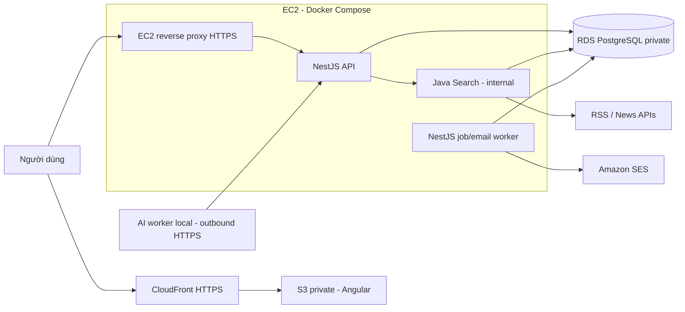

# Kế hoạch deploy AWS

Cập nhật: 13/11/2026. Đây là kế hoạch đề xuất dựa trên source hiện tại, chưa tạo tài nguyên AWS. Giả định: MVP ít traffic, chấp nhận downtime ngắn khi deploy và ưu tiên chi phí; ngân sách và cấu hình model chưa được chốt.

## 1. Hiện trạng

| Thành phần | Thực tế trong repo | Việc còn thiếu để deploy |
| --- | --- | --- |
| `apps/web` | Angular 20, client-side application | API URL, production build và hosting |
| `apps/api` | NestJS 11, scaffold, cổng mặc định 3000 | Database, auth, nghiệp vụ, health/readiness, cấu hình production |
| `apps/search_engine` | Spring Boot, Java 21, JDBC/JPA | PostgreSQL driver, datasource, chức năng collect/search, health/readiness |
| `apps/ai_engine` | `main.py` và `pyproject.toml` trống | Chọn worker/API, dependencies, model integration, entrypoint |
| Database | Thiết kế logic trong `docs/databases.md` | Migration SQL và migration runner |
| Hạ tầng | `infra/` chưa có cấu hình | Dockerfiles, Compose, IaC, pipeline và secrets |

Một số tài liệu cũ ghi Next.js hoặc frontend chưa chốt. Kế hoạch này theo Angular trong source thực tế; giữ tên thư mục có dấu gạch dưới đang dùng. `concurrently` dùng cho local development; production chạy image đã build, do Docker/ECS quản lý lifecycle.

## 2. Kiến trúc MVP đề xuất

| Nhu cầu | Lựa chọn |
| --- | --- |
| Region | Đề xuất `ap-southeast-1` (Singapore); xác nhận giá và dịch vụ trước khi provision |
| Frontend | S3 private bucket + CloudFront OAC + HTTPS |
| Backend | Một EC2 Linux chạy Docker Compose: reverse proxy, API, Search và email/job worker |
| Database | RDS PostgreSQL Single-AZ, private, bật backup; subnet group trải tối thiểu hai AZ |
| Container registry | ECR, tag theo Git commit, lifecycle policy |
| Email | SES, domain được xác minh, DKIM/SPF/DMARC, bounce/complaint handling |
| Secrets | Secrets Manager hoặc SSM Parameter Store SecureString, IAM role tối thiểu quyền |
| Logs và cảnh báo | CloudWatch Logs, alarms và AWS Budgets |
| IaC | Đề xuất Terraform, state từ xa có mã hóa và locking, tách môi trường |



Đề xuất domain `app.<domain>` cho web và `api.<domain>` cho backend. Frontend chỉ gọi API; giới hạn CORS theo origin và cấu hình cookie/CSRF phù hợp cơ chế auth. CloudFront dùng chứng chỉ ACM tại `us-east-1`; MVP backend kết thúc TLS ở Caddy/Nginx với chứng chỉ tự gia hạn. Khi chuyển sang ALB, dùng ACM tại region của ALB.

EC2 nằm public subnet, có route Internet Gateway và địa chỉ public để crawl và gọi AWS APIs; chỉ mở inbound 443, cổng 80 nếu cần redirect/ACME. Quản trị bằng SSM Session Manager. Không publish cổng API, Search hay database ra Internet; proxy truy cập container qua network nội bộ. RDS ở private subnet, chỉ nhận 5432 từ security group EC2. Với Docker, phải kiểm tra port publishing thực tế, không chỉ dựa vào firewall của host.

Một EC2 là điểm lỗi đơn và Compose không cung cấp rolling deployment. Nếu cần uptime cao ngay từ đầu, dùng phương án ECS ở mục 8. EC2 sizing phải dựa trên đo RAM/CPU Java, số crawler và concurrency; không đặt model lớn trên host backend khi chưa benchmark.

## 3. AI local trước, GPU cloud sau

Theo định hướng hiện tại, model và Python worker chạy trên máy local. Worker chủ động claim job qua API HTTPS được xác thực, gia hạn lease và trả JSON có cấu trúc; không mở model hoặc PostgreSQL ra Internet. Dùng credential riêng có thể thu hồi, giới hạn quyền claim/complete job. Chi tiết lease/idempotency theo thiết kế `background_jobs` trong database document.

Khi máy local offline: giữ job để retry có backoff, cảnh báo backlog, không gửi nội dung AI chưa hoàn thành. Chốt chính sách gửi bản tin thiếu tin hoặc bỏ lượt, thời hạn job và thời gian lưu dữ liệu. Claim và complete phải kiểm tra ownership/lease token để worker cũ không ghi đè kết quả mới. Bản tin chỉ dùng nội dung đã ready, không chờ model trong request của user.

Nếu cần xử lý liên tục: chuyển Python worker lên AWS; nếu model cần GPU, dùng EC2 GPU/ECS trên EC2 GPU sau benchmark. Fargate hiện không hỗ trợ GPU. Nếu chỉ chạy CPU hoặc gọi model endpoint bên ngoài thì có thể dùng Fargate.

## 4. Job, lịch gửi và dữ liệu

- MVP dùng bảng `background_jobs` đã được thiết kế, tránh bổ sung broker trước khi có nhu cầu. Worker là process riêng từ cùng codebase NestJS.
- Scheduler dò các cấu hình đến hạn, enqueue atomically với khóa duy nhất theo config và thời điểm gửi. Lưu timezone IANA, xử lý missed run/DST và tránh enqueue trùng khi nhiều replica chạy.
- Crawler, AI processing và email là các bước độc lập; tóm tắt trước giờ gửi. Email retry dùng snapshot bất biến. Theo dõi trường hợp provider đã nhận email nhưng worker chưa kịp ghi trạng thái; không tuyên bố bảo đảm exactly-once.
- Đề xuất PostgreSQL full-text search cho MVP. Chỉ chốt sau thử nghiệm; nếu dùng Lucene thì cần persistent EBS, snapshot và quy trình rebuild index, không lưu index duy nhất trong container.
- Một RDS instance có thể chứa nhiều schema/role theo ownership. Một migration runner có versioning, chạy trước release; không để nhiều app tự tạo/sửa cùng bảng khi startup.
- Bật RDS automated backups, đề xuất retention 7 ngày và diễn tập restore sang instance mới. Mục tiêu RPO/RTO phải được đo và chốt, không coi bật backup là đã có HA.

## 5. Thứ tự triển khai

| Giai đoạn | Công việc | Điều kiện hoàn thành |
| --- | --- | --- |
| 1. Chuẩn hóa build | Chốt package manager/lockfile từng app, kiểm tra Java/dependency resolution, tạo AI entrypoint, Dockerfile multi-stage và `.dockerignore` | Image build tái lập được, chạy bằng production command, không dùng watch/dev server |
| 2. Local integration | Compose cho API, Search, worker và PostgreSQL; migration; env examples; health/readiness; timeout và graceful shutdown | Một luồng collect → AI → lưu kết quả → email thử chạy được; restart giữ dữ liệu |
| 3. AWS foundation | Account MFA, budgets, IAM, VPC/subnets/security groups, ECR, RDS, EC2, S3/CloudFront, secrets, logs | Hạ tầng tái tạo bằng IaC; không public DB/Search; HTTPS hoạt động |
| 4. Staging release | Build/push image, migration một lần, deploy qua SSM, upload web, cấu hình SES thử nghiệm | Healthcheck và smoke test pass; rollback image được; restore DB được |
| 5. Public MVP | Domain, SES production access, auth/rate limits/unsubscribe, cảnh báo, backup, lịch gửi | User thử đăng ký và nhận bản tin; lỗi AI/local offline không làm API ngừng phục vụ |
| 6. Theo dõi tải | Đo memory/CPU, DB connections, queue age, delivery lag và chi phí | Có số liệu quyết định scale và chuyển ECS |

Staging và production phải tách dữ liệu, secrets và email recipients. Có thể dựng staging theo nhu cầu để giảm chi phí; production deploy dùng release tag và bước phê duyệt. Không triển khai chức năng chưa có chỉ để healthcheck xanh.

## 6. CI/CD và rollback

Đề xuất GitHub Actions nếu repo dùng GitHub; provider khác áp dụng cùng nguyên tắc:

1. PR chạy kiểm tra/build cho app thay đổi; thay đổi shared contracts kích hoạt các consumer liên quan.
2. Release build image trên runner, push ECR với commit SHA; frontend build artifact được lưu theo version.
3. CI dùng OIDC assume role có trust policy giới hạn repo/ref/environment; không lưu AWS access key dài hạn trong CI.
4. Chạy migration tương thích ngược bằng job có khóa, thất bại thì dừng deploy. Dùng expand/contract cho thay đổi phá vỡ schema.
5. Qua SSM, server lấy secrets vào file được giới hạn quyền bên ngoài repo, pull image và `docker compose up -d`. EC2 instance role chỉ có các quyền runtime cần thiết; tách quyền CI và migration.
6. Kiểm tra readiness, HTTPS, DB access và smoke test. Upload Angular artifact tới S3, assets có hash cache dài, `index.html` cache ngắn; rewrite route SPA mà vẫn giữ 404 cho asset thiếu.
7. Lỗi thì rollback image/manifest và web artifact trước. Không tự động downgrade schema hoặc restore DB đè dữ liệu mới; cần kế hoạch riêng khi migration không tương thích.

Worker cần drain hoặc bảo toàn lease khi deploy; dừng nhận job mới, xử lý signal rồi thoát trong timeout. Compose restart policy, healthcheck và CloudWatch alarm cần phối hợp; unhealthy không tự có nghĩa container đã được restart.

## 7. Chi phí và vận hành

Chưa chốt số tiền/tháng vì thiếu ngân sách, traffic, số email/bài viết và cấu hình AI. Lập AWS Pricing Calculator theo region trước khi provision, tính cả:

- EC2 giờ chạy + EBS + public IPv4, RDS compute/storage/backups.
- S3/CloudFront requests và transfer, SES sends, ECR storage, CloudWatch ingestion/retention, secrets, DNS/domain.
- Khi chuyển ECS: Fargate compute, ALB, NAT gateway hoặc VPC endpoints và data processing; GPU tính riêng.

MVP public-subnet EC2 tránh yêu cầu NAT gateway cho outbound của host. Với ECS private subnets, crawler vẫn cần đường Internet outbound; VPC endpoints không thay thế được đường crawl website công khai. Không giả định Free Tier sẽ bao phủ hệ thống.

Đặt log retention, ECR lifecycle, AWS Budgets và cảnh báo chi phí bất thường. Theo dõi uptime, 5xx, disk/RAM, DB connections/storage, job age, tỷ lệ retry, email bounce/complaint và độ trễ gửi. Budgets là cảnh báo, không phải hard spending cap.

## 8. Khi nào chuyển ECS/Fargate

Chuyển khi cần deploy ít downtime, nhiều replica hoặc scale crawler/worker độc lập:

- Public ALB ở hai AZ → API ECS service private; Search và workers là service/task riêng; internal HTTP qua service discovery hoặc Service Connect.
- ECR, RDS, SES, S3/CloudFront và contracts giữ lại. Secrets dùng task roles và execution roles riêng.
- Cấu hình desired count, autoscaling, readiness và deployment circuit breaker. Với yêu cầu HA, API chạy tối thiểu hai task và RDS Multi-AZ; EC2 GPU là nhóm compute riêng nếu cần.
- Private tasks có NAT/egress phù hợp; đo chi phí network trước khi chốt. Nếu dùng local disk index, thiết kế lại persistence trước khi tăng replica.
- Nếu DB job queue trở thành nút thắt hoặc cần tách worker local mạnh hơn, đánh giá SQS + DLQ, transactional outbox và idempotent consumer. Không triển khai đồng thời hai hệ thống queue không có ranh giới rõ ràng.

## 9. File dự kiến bổ sung ở bước implementation

```text
apps/api/Dockerfile
apps/api/.dockerignore
apps/search_engine/Dockerfile
apps/search_engine/.dockerignore
apps/ai_engine/Dockerfile            # Khi entrypoint/dependencies đã có
apps/ai_engine/.dockerignore
infra/compose.dev.yaml
infra/compose.prod.yaml
infra/Caddyfile
infra/terraform/
infra/scripts/deploy.sh
infra/scripts/rollback.sh
.github/workflows/ci.yml             # Nếu dùng GitHub
.github/workflows/deploy.yml
.env.example
```

Frontend static hosting không bắt buộc Dockerfile production. Mỗi app có env contract, không tự động dùng chung `.env` ở root. Web chỉ nhận cấu hình public; không đưa secret vào Angular bundle. Chốt ngân sách/tháng, domain, Git host, workload và phần cứng AI trước khi sizing/IaC.

## 10. Nguồn AWS đã đối chiếu

- [CloudFront OAC cho S3 private](https://docs.aws.amazon.com/AmazonCloudFront/latest/DeveloperGuide/private-content-restricting-access-to-s3.html).
- [Fargate FAQ — GPU cần EC2](https://aws.amazon.com/fargate/faqs/).
- [SES production access và giới hạn sandbox theo region](https://docs.aws.amazon.com/ses/latest/dg/request-production-access.html).
- [RDS automated backups và point-in-time recovery](https://docs.aws.amazon.com/AmazonRDS/latest/UserGuide/USER_WorkingWithAutomatedBackups.html).
- [IAM OIDC và temporary credentials](https://docs.aws.amazon.com/IAM/latest/UserGuide/id_roles_providers_create_oidc.html).
- [VPC pricing — NAT gateway và public IPv4](https://aws.amazon.com/vpc/pricing/).
